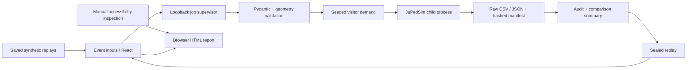
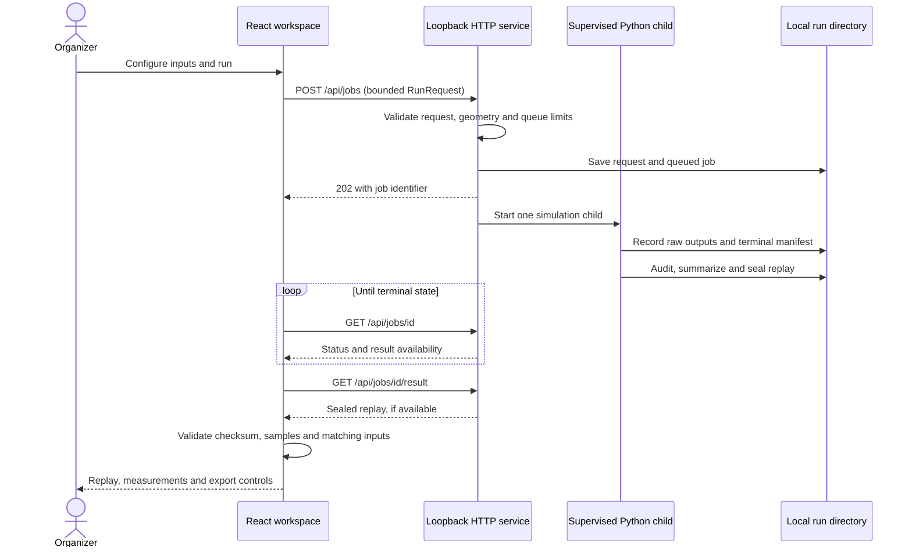

# Pathway technical design document

Pathway combines the organizer workflow and the existing simulation engine in one local application. The browser uses React/TypeScript, Vite and Tailwind. Python 3.12 uses JuPedSim 1.4.2, Pydantic and Shapely; PedPy is optional analysis. No accounts, database or external API are required.

This document describes the implemented local application, its data contracts, execution boundaries and verification strategy. Geometry is a synthetic 60 × 40 m venue; coordinates use metres and engine time uses seconds. Organizer-facing arrival controls convert minutes to seconds without changing the simulation model. Event descriptions and inspection records are separate from simulation inputs.

## Fresh-run request lifecycle

A cancelled, timed-out or failed job remains explicitly labelled. Partial output is shown only when a sealed replay exists. Changing inputs invalidates the active result; a late job cannot replace a newer draft with mismatched evidence. Saved demonstrations bypass computation and enter through the same replay validation path.

## HTTP and file contracts

| Endpoint | Responsibility |
| --- | --- |
| `GET /api/bootstrap` | Default inputs, local jobs and execution limits. |
| `POST /api/preview` | Validate a request and return generated scenario/request hashes without running it. |
| `POST /api/jobs` | Validate and enqueue a simulation; return its job record. |
| `GET /api/jobs` / `GET /api/jobs/{id}` | List jobs or inspect one job's status. |
| `POST /api/jobs/{id}/cancel` | Request cancellation; preserve the actual terminal status and available partial evidence. |
| `GET /api/jobs/{id}/result` | Retrieve a sealed replay, or report that output is unavailable. |

`RunRequest` contains `variant`, `count`, `seed` and validated Puja `settings`. Browser requests accept 1–750 visitors. Job identifiers are server-generated hexadecimal values; arbitrary file paths or executable commands cannot be supplied through the API. Inputs use strict validation and finite numerical bounds.

Raw outputs include `scenario.json`, `demand.json`, trajectory/ledger/zone/flow CSVs, events, visitor timings and `manifest.json`. The replay's `pathway-replay-1` payload contains the original request, scenario, manifest, summary, display frames, ledger and zone samples. Its SHA256 envelope detects byte changes; it is not an authenticity signature or a scientific validation certificate. Manual inspection JSON is a separate versioned document and never changes the simulation hash.

## Execution and storage boundaries

The service checks loopback Host and Origin headers, JSON content type and a 65,536-byte request limit. One simulation runs at a time with at most two queued jobs. Defaults bound retained jobs to 32 and stored output to 2 GB, with a 300-second cooperative wall timeout and 345-second hard supervision limit. Child resource limits and thread settings remain in the existing supervisor. Restarted unfinished jobs become `interrupted`; the service does not silently resume them.

The browser and Python service run on the same machine. No authentication or public simulation endpoint is implemented. A static build can replay saved/imported outputs but cannot execute fresh simulations. Inspection persistence is explicit JSON import/export rather than automatic storage. See the [README configuration section](../README.md#configuration-and-environment-variables) for actual server arguments and optional test variables.

## Engine and inputs

`schema.py` defines frozen versioned inputs, reference checks and bounds in metres/seconds. `puja.py` generates the 60 × 40 m synthetic venue and baseline, additional-exit and staggered alternatives. It allocates integer visitors by largest remainder at each origin/lane/preference/pulse split. `geometry.py` checks valid connected walkable geometry, body clearance and routing without silently repairing inputs.

`demand.py` draws independent seeded arrival, speed, service and spawn attributes per visitor identifier. The additional-exit intervention changes geometry **and assigned exit routes**; staggering changes arrival times, preserving matched attributes. `fixtures.py` supplies kernel examples.

`runner.py` admits timed arrivals through FIFO outside waiting lists. Blocked arrivals remain waiting. Visitors follow assigned JuPedSim journeys through native service queues to exits. Queue heads wait for sampled service durations before release. The run stops at clearance, horizon, cancellation, timeout or failure, retaining partial evidence and explicit unfinished demand. The supervisor can terminate a child that exceeds its execution budget.

## Measurements and comparison

`metrics.py` counts zone membership (including boundaries) and divides by usable zone area; speeds use displacement windows. Directional crossings count recrossings. `output.py` writes trajectories, ledger, zones, flow, events and visitor records plus hashes, environment and terminal status. `audit.py` checks raw output consistency. `comparison.py` audits runs, checks matched visitor attributes and summarizes journey censoring, outside waiting, formal queues, population and per-zone exposure. Person-seconds use trapezoidal integration; occupied/slow durations use the preceding sample. Overlapping zones cannot be summed. No metric is a safety score.

`study.py` supports bounded, resumable repeated studies; `cli.py` preserves validate/run/schema/puja/compare commands. The browser comparison gate checks visitor identity, horizon, observation availability and measurement definitions; additional product explanations use only permitted deltas.

## Local service and browser

`server.py` accepts bounded requests on loopback, checks host/origin/body limits and supervises one restricted child through `webworker.py`. Jobs have explicit pending/running/cancelled/timed-out/failed states. `replay.py` seals replay JSON with SHA256, keeps analytical summaries and downsamples display positions to held 2-second frames rounded to 0.001 m. Measurements retain their original 1-second sampling.

`App.tsx` coordinates draft inputs, previews, job polling, history, replay and pinned reference. `Venue.tsx` renders fixed-template geometry and recorded pedestrians; it does not run physics. `model.ts` validates requests and imported replays, invalidates mismatched drafts, gates comparisons and exports HTML/scenario/replay files. Saved fixtures are recorded synthetic results, not fresh runs; imported files are explicitly labelled. Fresh runs use the local service. Static hosting supports saved replays only.

The organizer modules add descriptive event metadata, an exact allocation preview, separate manual inspection findings and deterministic explanation/report sections. They do not change simulation hashes, metrics or request contracts. Audit context includes event and gate/layout assumptions; mismatches require review. Reports combine separately labelled evidence; audit data is never represented as part of the simulation manifest.

## Organizer modules

- `planning.ts`: descriptive event metadata and an inspection context key for event/template/scenario/gate assumptions.
- `arrivals.ts` and `ArrivalPreview.tsx`: minute/percentage conversion, the same nested largest-remainder allocation as `puja.py`, theoretical staggered-window expectations and separately labelled observed ledger arrivals.
- `accessibility.ts` and `AccessibilityAudit.tsx`: versioned manually reported records; pure source-linked checks; validated explicit JSON import/export, reset and stale-context review. Records stay separate from pedestrian physics. Export before leaving the page; there is no automatic browser persistence.
- `decision.ts` and `DecisionSummary.tsx`: compatibility-gated exposure/completion differences, adverse zone changes and practical review prompts. Horizon-limited usable outputs retain censoring caveats; failed or unmatched comparisons do not produce comparative conclusions.
- `planningReport.ts` and `ReportPanel.tsx`: event overview, separate manual audit, prioritized review checklist and attribution integrated through the existing `reportHtml()` export. The optional third argument preserves existing callers. User text is escaped; print CSS supports browser PDF saving. No simulation manifest or hash is modified.
- `EventSetup.tsx`: optional event identity, source descriptor and selected input overview; changes to metadata do not alter simulation requests.

## Crowd Patterns analytical views

`analytics.ts` validates the analytical zone samples and ledger fields consumed by charts, builds zone series, resolves the latest available sample within its cadence, retains missing values, identifies evidence-linked review locations, and exports full-precision zone CSV. `decodeEnvelope()` invokes these checks after existing replay checks. Malformed samples are rejected even if a file has a valid checksum. Missing rows remain unavailable rather than reconstructed.

`chartSvg.ts` renders dependency-free SVG timelines, zone-time density windows and comparison bars. Both the React dashboard and HTML report use these renderers. Curves break at null values or gaps longer than the measurement interval; isolated observations remain visible. Density windows retain the actual maximum sample and timestamp. Shared colour/axis domains are relative to displayed compatible runs, with no safety categories. `analyticsComparison.ts` supplies separate per-zone and population comparison rows.

`CrowdPatterns.tsx` connects zone selection, map modes, the shared time cursor, density/speed charts, a zone-time heatmap, population accounting, original data tables and CSV download. Compatible references share chart axes and map scales. A cursor can inspect the later of two actual run ends; the earlier run's analytical observation is then unavailable. `Venue.tsx` clips the selected zone fill to walkable geometry, leaves overlapping zones as outlines, and supports pointer selection with a selector as a keyboard alternative. Whole-run aggregate map modes omit pedestrian snapshots.

`ComparisonCharts.tsx` preserves the existing compatibility gate and labels changed usable areas. `AnalyticsCharts.tsx` supplies SVG timeline interaction and legends. `analyticsReport.ts` adds the same static SVG evidence, original sample tables and an embedded CSV to `reportHtml()`, without external resources or changes to manifest hashes. Full sample tables are hidden only for printing so reports stay readable; the HTML retains the original data. No backend schema, raw metric, physics or replay format changes are required.

## Verification and extension boundaries

Python tests cover schema/geometry rejection, reproducible demand, population conservation, queues, measurements, exports, comparison and local job supervision. Frontend tests cover arrival allocation against backend-generated fixtures, inspection rules and persistence, compatibility rejection, chart missingness and escaped reports. Browser workflows exercise saved and fresh runs, cancellation, incomplete output, stale inputs, keyboard/mobile use, comparisons and actual downloads. Commands and recorded results are in [verification status](BASELINE_STATUS.md).

Future CSV arrival schedules require coordinated scenario/request/UI changes; rendering uploaded data alone would not change simulated demand. A surveyed venue editor requires generalized geometry generation and rendering. Field calibration requires real observations and held-out comparisons. None of these capabilities, nor accident likelihood or mobility-specific physics, is supplied by the present implementation.
